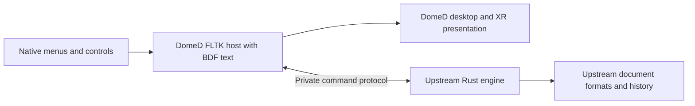

> Historical five-application report. Current maintained scope is WordCraft,
> GridCraft, DeckCraft and the separately packaged PhotoCraft. VectorCraft is
> excluded. See [OFFICE-PORT.md](OFFICE-PORT.md) and [PHOTO-PORT.md](PHOTO-PORT.md)
> for the current implementation and verified limits.

# DomeD ports of the five Storytold applications

The historical five-application scope was **WordCraft, GridCraft and DeckCraft as DomeD's office
suite**, replacing the retired Calligra fork, and **PhotoCraft and VectorCraft
as its art suite**. The ArtCraft AI application and Craft Launcher are outside
this port. SoundCraft, DesignCraft and LightCraft are future targets recorded
in the shared registry; they have no source fetch, build, launcher or defaults.

## Viability finding

The approach is viable as maintained native frontend ports over the upstream
engines. It is not a drop-in replacement of the upstream GUI toolkit. Each
application has a layered Rust engine, command catalogue and headless interface;
the native egui frontend sits above that seam. The first port uses those real
engines in private child processes and drives their existing commands. The
earlier `.wordcraft`/`.gridcraft` test JSON models are not used or converted into
upstream documents by this path.

The primary sources are the pinned repositories and their architecture:
[WordCraft](https://github.com/storytold/wordcraft),
[GridCraft](https://github.com/storytold/gridcraft),
[DeckCraft](https://github.com/storytold/deckcraft),
[PhotoCraft](https://github.com/storytold/photocraft),
[VectorCraft](https://github.com/storytold/vectorcraft).
Their exact revisions, licence hashes, backend tools and suite membership are
recorded in `upstream.lock.json`. Original checkouts remain unmodified. No upstream issue
comments, PRs, publishing or remote forks are created by this work.

The name distinction matters: [storytold/artcraft](https://github.com/storytold/artcraft)
is an AI creation application, while [craft-launcher](https://github.com/storytold/craft-launcher)
installs the larger suite. Neither is the shared document engine for these five.
The existing local directory/library name `artcraft` is retained for compatibility
with the shared DomeD base and its tests; it does not mean either application is
being ported.



| DomeD convention | Present implementation | Work needed for full native editors |
| --- | --- | --- |
| BDF bitmap fonts | All workbench controls, menus and inspection text use the canonical DomeD BDF runtime. No egui frontend is launched. | Upstream document text/layout uses outline-oriented font APIs (Skrifa/Harfrust and related libraries). A BDF provider and metrics/layout tests are required before a full canvas meets the same rule. Do not silently use an outline-font raster preview as proof of bitmap document rendering. |
| Universal menu | Real New/Open/Save As/Undo/Redo and selected-command execution use the upstream session, with cached enabled state. | Generate complete native command menus and app-specific controls; preserve selection, checked state, parameter dialogs and keyboard conventions. |
| Tray manager | The shared optional StatusNotifier item exports the native command menu; hide/restore follows the shared lifecycle. | Per-app background-job status, cancellation and safe unsaved-document shutdown. Editors need not become permanent tray services. |
| Native GPU path | The native host is FLTK/OpenGL on Wayland. Explicit QA capture reads its GL framebuffer. | Replace document-view code with retained native geometry/glyph/image resources, damage tracking and app-specific GPU paths. Upstream CPU raster previews and PhotoCraft's CPU headless build are not end-to-end GPU evidence. |
| Desktop/XR presentation | Only the native host owns a Wayland connection. Realm-aware wrappers use `dome-link`; the backend has no GUI or OpenXR session. | Real-headset input/readability, popup placement, promotion on XR loss and multi-document routing checks. |
| Existing upstream packages | Real engines, native file formats, commands, history and serializers are retained at pinned revisions. | Each source/version needs an adapter and compatibility tests. Unchanged upstream GUI release binaries do not gain DomeD conventions from a launcher alone. |

The largest shared risk is the text/rendering seam, not menus or process
transport. WordCraft pagination, GridCraft text measurement and DeckCraft text
boxes must use compatible metrics. PhotoCraft and VectorCraft also have text
layers/objects. Keep font metadata and unsupported features in the authoritative
upstream model while the native view is developed. Full original typography
cannot be promised when only bitmap faces are available.

A format-seam probe (`ports/bdf-probe.rs`) compiled against the engines' cached
Skrifa 0.47 accepted a minimal SFNT directory but rejected a real installed
DomeD BDF with `InvalidSfnt`. The probe does not install or bundle a font and
is not a shaping/fidelity test. Its measured result confirms that changing the
host's theme alone cannot supply the missing document-font backend.

## First implementation

`DomeCraft::Upstream` provides a persistent MCP/JSON-RPC client and session
adapter. The process uses a private Unix socket pair for stdin/stdout, no shell
or listening socket, bounded request/reply size and nesting, matched request
IDs, deadlines and child cleanup. A protocol fault disables subsequent transport
use; a normal command rejection leaves the session available. PhotoCraft's
inherited remote-control environment is removed so it cannot connect to an
unrelated running app. VectorCraft starts in Safe Mode to avoid loading plug-ins.

WordCraft's current `Registry::describe` does not expose enabled predicates.
The adapter derives Undo/Redo availability from document inspection; other rows
with missing information are marked `enabled_known: false` and shown with `?`.
The engine checks them on invocation. Complete native menu-state fidelity needs
an upstream state-query seam; a missing predicate is not treated as proof that
the command can run.

Five `*-domed-native` hosts use `ArtCraft::Platform`, the already implemented
DomeD native base. The hosts run engine work off the FLTK thread, show the real
command catalogue and parameters, and inspect the real document. Each starts
with an application-specific editing command. Saves and opens go through the
upstream serializers, not the earlier test-file implementation.

**This is an upstream command workbench, not a finished document canvas.** It
does not yet implement native caret/selection, IME integration, rich layout,
graphics tools, a complete menu tree or recovery. Its dirty flag is conservative;
closing unsaved work offers Cancel/Discard. Save As is explicit. The private
engine transport is a control plane; it is not the eventual GPU or audio data
plane.

The initial workspace directory scopes curated Open/Save operations. WordCraft,
DeckCraft, PhotoCraft and VectorCraft additionally receive their existing
upstream read/write-root options. GridCraft's CLI does not expose those options;
the private transport is not advertised as a process-wide sandbox. A file passed
at launch selects its parent directory as the workspace. Use `--workspace DIR`
to select it explicitly. This limitation must be removed or replaced with a
proper native file-grant flow before normal desktop deployment.

No document renderer is ported merely by compiling it as an unused dependency.
The first PhotoCraft CLI build disables its default GPU feature for headless
control testing; native image processing/rendering integration is a later gate.
No corpus from proprietary applications is added, no vendor artwork is copied,
and the upstream licence/notice files remain with their sources.

## Build and run

The base prerequisites still apply, plus a Rust toolchain satisfying the pinned
upstream manifests, Cargo's network access and enough disk for dependencies.
The upstream sources are MIT OR Apache-2.0. The source helper verifies exact
revisions, tracked-tree cleanliness and licence hashes before building. It
never silently resets or patches an existing checkout.

The pinned PhotoCraft revision has duplicate `TAG_JPEG_TABLES` and
`TAG_PREDICTOR` constants in its TIFF decoder, which prevent compilation. The
recorded build patch removes only the duplicate block, matching the narrow fix
in [upstream PR 13129](https://github.com/storytold/photocraft/pull/13129), which
was open when inspected. It is applied in a separate detached build worktree;
patch and resulting source hashes are locked. The original checkout and its
Cargo lock remain unchanged. This is a build fix, not a TIFF-behavior port.

```sh
python3 scripts/upstream.py fetch
python3 scripts/upstream.py verify
python3 scripts/upstream.py build
cmake -S . -B build -G Ninja -DCMAKE_BUILD_TYPE=RelWithDebInfo \
  -DCMAKE_PREFIX_PATH=/opt/fltk-vr/toolkit
cmake --build build -j 3
./build/wordcraft-domed-native --workspace /path/to/documents
./build/gridcraft-domed-native /path/to/book.xlsx
```

The source checkouts live in ignored `upstream/`; reproducibility is recorded by
the lock file, not by committing a second copy of their source. Cargo outputs
share `build-upstream/target`; five upstream release CLIs are built without their
GUI applications. Full upstream CI, corpus and GUI/wasm suites are not implied by
building these targets. Their workspace lock files remain intact.

## Office defaults and staging

The canonical planned suite policy is
`../dome-compositor/packaging/craft-suite.json`. It selects WordCraft for DOCX/ODT,
GridCraft for XLSX and DeckCraft for PPTX. It leaves general text/CSV/image viewer
preferences alone. ODS is not assigned as a lossless editor because upstream
describes data import; ODP support is not established and is not advertised.
PhotoCraft and VectorCraft are installed as art tools without taking image-viewer
defaults. Future targets and ArtCraft have no handlers.

```sh
python3 scripts/stage-domed-ports.py build/domed-stage
# Or stage only one suite:
python3 scripts/stage-domed-ports.py build/domed-office-stage --suite office
```

The stage contains five native hosts, adjacent realm-aware
wrappers, private backend binaries, desktop entries, licence/notice records,
the source lock and hashes. A prepared `integration/dome-mimeapps.list` records
the office defaults. `--mimeapps FILE` merges an existing DomeD preference file,
preserving unrelated entries and removing retired Calligra entries only for the
controlled office types. The stage is not a system installer and never activates
defaults or restarts a session. A distributable release also needs transitive
licence/source packaging and a compatible native runtime.
When no office applications are selected (`--suite art`), no office preference
file is generated.

The initial inspection workbench is deliberately not activated as the live
office desktop default. Activate the prepared policy with the actual installation
only after native document editing and preservation gates pass; otherwise a
default association would overstate the readiness of the port.

## Next gates

1. Independently check actual upstream save/reopen and the native menu path for
   all five applications; keep malformed-transport and failure tests green.
2. Add versioned app-specific view adapters, native selection and text input.
   Keep all mutations in the real upstream command system.
3. Add a shared BDF font/measurement seam, then validate document text, IME and
   pagination against declared bitmap metrics. Keep original imported files.
4. Port retained GPU canvases and pointer/tool gestures. Treat CPU fallback and
   readback as explicit paths; test context loss and DMA-BUF ownership.
5. Complete per-app file-grant, dirty-state, recovery and full menu adapters.
   Verify desktop/XR behavior before activating the office defaults.

SoundCraft can reuse command/session/menu/routing infrastructure but will need
a separate real-time audio transport. DesignCraft can reuse text/page/canvas
work; LightCraft can reuse raster/color/RAW work. Their existence in the registry
is an extension point, not a claim of compatibility or a commitment to port them.

## Validation commands

```sh
ctest --test-dir build --output-on-failure
/usr/bin/python3 tests/ports-native.py build > build-upstream/native-validation.json
python3 tests/ports-stage.py build office > build-upstream/office-stage-validation.json
python3 tests/ports-stage.py build all > build-upstream/stage-validation.json
```

The native checks use a private D-Bus session on the existing Wayland display,
perform real engine edits through exported menu actions, save native files and
reopen them in a new process. Office archive/XML contents are independently
checked. This is not a physical-headset or full upstream compatibility/corpus
certification. Stage checks verify hashes, file associations, exact launcher
arguments and the absence of missing/GTK/Qt libraries in the built binaries.

The initial 2026-11-11 validation built all five pinned optimized backends and
native hosts. Four default CTests passed; all five native command/edit/save/reopen
flows passed. DOCX, XLSX, PPTX, ODT, `.pcraft` manifests and `.vectorcraft` path
data received independent format checks. Office, art-only and complete stages
passed their policy/launcher/linkage checks. The patched PhotoCraft codec's
focused TIFF suite passed 15 tests (160 filtered out); full upstream CI and
corpus suites were not run. Native captures used the Intel GL renderer and a
private session bus; physical XR and real shell-menu clicking remain unverified.
